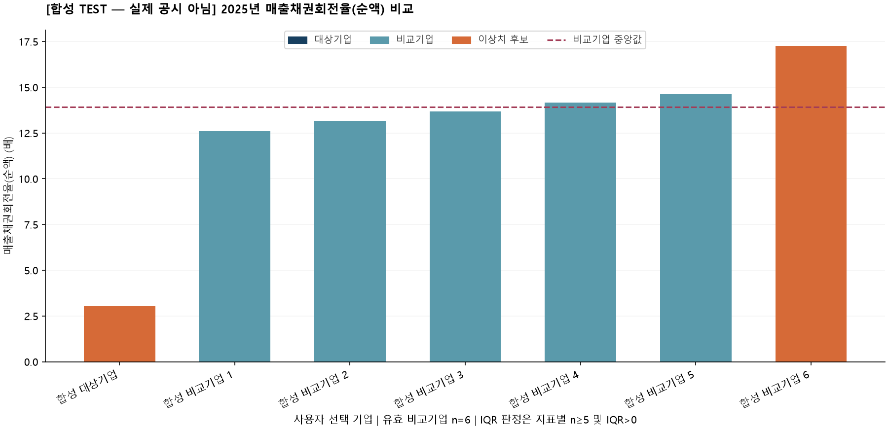

# OpenDART Peer Financial Analyzer

OpenDART에서 기업별 재무제표를 받아 최근 3개 사업연도의 매출채권회전율, 매출총이익률, 재고자산회전율을 비교합니다. 비교기업과 차이가 크거나 전년 대비 변동이 큰 항목을 표시하고, 결과를 Excel과 그래프로 저장합니다.

매출채권은 순액과 총액을 구분하며, 주석에서 확인한 손실충당금과 기대신용손실(ECL)도 함께 검토합니다.

`--demo`와 아래 예시는 실행 확인용 가상 데이터를 사용합니다.



## 주요 기능

| 분석 | 구현 내용 |
|---|---|
| 재무비율 | 매출채권회전율, 매출총이익률, 재고자산회전율 |
| 보조 지표 | 매출채권·재고자산 회전기간, 총액 기준 매출채권회전율 |
| 비교 | 대상기업 1개 + 사용자가 고른 비교기업 1~10개(권장 5~10개), 평균·중앙값·차이·순위 |
| 횡단면 이상치 | 지표별 유효 비교기업 5개 이상일 때 IQR 기준 |
| 연도별 변동 | 전년 대비 급등·급락, 3개년 연속 하락 |
| 대손·ECL | 총액/순액 구분, 충당금 설정률, 매출 대비 ECL 비용, 제각, 충당금 변동 대사 |
| 계산 근거 | API 원문 JSON, 선택 계정·후보·접수번호, 주석 출처, 입력 파일 해시 |
| 저장 파일 | 10개 시트 Excel, 한글 PNG 6개, 원본 스냅샷, 실행 명세 |

매출채권회전율을 계산하려면 공시 주석에서 순액 여부와 채권 범위를 확인해 입력해야 합니다. ECL 관련 금액도 같은 방식으로 보완합니다. 주석 자료가 없으면 해당 지표는 빈칸으로 남고, 매출총이익률과 재고자산회전율은 확보된 자료로 계산합니다.

## 설치

Windows와 Python 3.12 기준입니다. 저장소를 내려받은 뒤 `main.py`가 있는 폴더에서 PowerShell을 열고 실행합니다.

```powershell
py -3.12 --version
py -3.12 -m venv .venv
.\.venv\Scripts\python.exe -m pip install -r requirements.txt
```

가상환경의 Python을 직접 호출하는 방식입니다. `py` 명령을 찾을 수 없다면 설치된 Python 3.12의 실행 파일 경로를 지정합니다.

테스트 환경과 같은 패키지 버전으로 설치하려면 다음 명령을 사용합니다.

```powershell
.\.venv\Scripts\python.exe -m pip install -r requirements-lock.txt
```

`requirements.txt`는 호환 범위, `requirements-lock.txt`는 Windows/Python 3.12에서 실제 테스트한 전체 의존성 버전 목록입니다.

## API 키 설정

[OpenDART](https://opendart.fss.or.kr/)에서 발급받은 인증키를 `.env`에 입력합니다.

```powershell
Copy-Item .env.example .env
notepad .env
```

`.env`의 값을 본인의 40자리 인증키로 바꾸고 저장합니다.

```dotenv
OPENDART_API_KEY=발급받은_실제_40자리_인증키
```

`.env`는 Git 업로드 대상에서 제외됩니다. 같은 이름의 환경변수가 있으면 환경변수 값을 우선 사용합니다. 오류 메시지에는 인증키를 포함하지 않습니다.

## 실행

### 예제 실행

```powershell
.\.venv\Scripts\python.exe main.py --demo
```

가상 기업 7개의 자료로 계산과 보고서 생성을 실행합니다. API 키와 인터넷 연결 없이 사용할 수 있습니다.

### 실제 기업 분석

```powershell
# 2023~2025 분석, 2022 기초잔액 보조 조회
.\.venv\Scripts\python.exe main.py --target "삼성전자" --peers "SK하이닉스" --end-year 2025

# 기업명을 대화형으로 입력. 기간 기본값 2023~2025
.\.venv\Scripts\python.exe main.py
```

위 명령은 기업명 입력 예시입니다. 비교기업이 1개이면 비율 비교는 가능하지만 IQR 이상치 판정은 생략됩니다. 비교기업을 늘리려면 `--peers` 뒤에 기업명을 추가합니다. 업종과 사업구조가 유사한 기업 5~10개를 선택하는 것을 권장합니다.

```powershell
# 기업명을 실제 선택한 이름으로 바꿔 실행
.\.venv\Scripts\python.exe main.py --target "대상기업명" --peers "비교기업1" "비교기업2" "비교기업3" "비교기업4" "비교기업5" --start-year 2023 --end-year 2025
```

동명 기업은 `"기업명@8자리DART고유번호"`로 구별합니다. 예: `"삼성전자@00126380"`. 잘못된 이름이나 일부 이름을 입력하면 후보를 제시하고 멈추며, 임의 기업을 선택하지 않습니다. 대상기업과 비교기업의 중복은 허용하지 않습니다.

분석 기간은 연속 3개년이며 기본값은 2023~2025년입니다. 기초잔액을 조회할 수 있도록 시작연도는 2016년 이후로 제한합니다. 사업보고서가 없는 연도는 계산 불가로 표시됩니다.

### 주석 자료와 변동 기준 지정

```powershell
Copy-Item credit_notes.example.json credit_notes.local.json
notepad credit_notes.local.json

.\.venv\Scripts\python.exe main.py --target "삼성전자" --peers "SK하이닉스" --credit-notes credit_notes.local.json --turnover-change 0.30 --margin-change-pp 5
```

예제 JSON에 공시 접수번호, 주석 위치와 금액을 입력합니다. 항목별 작성 방법은 [주석 입력 가이드](docs/CREDIT_NOTES.md)에 정리했습니다.

### 저장된 자료로 다시 실행

```powershell
.\.venv\Scripts\python.exe main.py --snapshot examples/synthetic_demo/raw_snapshot.json --credit-notes examples/synthetic_demo/credit_notes.json --output-dir reports/replay_demo
```

저장된 `raw_snapshot.json`의 기업과 연도를 사용하므로 API를 다시 호출하지 않습니다. 이전 결과를 재현하려면 주석 파일, 매출채권 범위와 변동 기준도 같아야 합니다. 입력 파일의 변경 여부는 `manifest.json`에 저장된 SHA-256으로 확인할 수 있습니다.

결과는 기본적으로 `reports/run_실행시각/`에 저장됩니다. `--output-dir`로 경로를 지정할 수 있지만 기존 파일이 있는 폴더는 덮어쓰지 않습니다. 실패한 실행이 만든 폴더가 남으면 새 경로로 실행하세요.

## 재무비율 계산

| 지표 | 계산식 | 단위 |
|---|---|---|
| 매출채권회전율(기본) | 매출액 ÷ ((기초 매출채권 순액 + 기말 순액) ÷ 2) | 배 |
| 매출채권회전기간 | 365 ÷ 순액 기준 회전율 | 일 |
| 매출총이익률 | (매출액 − 매출원가) ÷ 매출액 | % |
| 재고자산회전율 | 매출원가 ÷ ((기초 재고자산 + 기말 재고자산) ÷ 2) | 배 |
| 재고자산회전기간 | 365 ÷ 재고자산회전율 | 일 |
| 매출채권회전율(총액, 보조) | 매출액 ÷ 평균 매출채권 총액 | 배 |
| 손실충당금 설정률 | 기말 매출채권 손실충당금 ÷ 기말 매출채권 총액 | % |
| ECL 비용/매출 | 당기 매출채권 관련 ECL 비용(환입은 음수) ÷ 매출액 | % |

Python 내부에서는 비율을 소수로 계산합니다. `0.25`는 Excel에서 `25.0%`로 표시하며, 이익률 `25% − 20%`의 차이는 `5%p`입니다. 분모 0/음수나 자료 누락은 계산 불가입니다. 회전율 0 자체는 유효하지만 대응 회전기간은 계산할 수 없습니다. 매출원가의 음수를 임의로 양수로 뒤집지 않습니다.

매출채권회전율의 분자는 전체 매출액입니다. 신용매출액은 별도로 구분하지 않습니다. IQR 비교에는 순액 기준 회전율을 사용하고 총액 기준은 보조 지표로 표시합니다. 회전기간은 윤년에도 365일 기준입니다.

### 매출채권과 신용손실

- 매출채권만 사용합니다. 기타채권이나 계약자산이 합쳐진 계정은 제외합니다.
- 기본 비교 범위는 **전체 매출채권(`total_trade`)**입니다. 모든 기업에 유동 매출채권만 적용하려면 `--receivables-scope current_trade`를 지정하고 주석 범위도 일치시켜야 합니다.
- API의 `매출채권`이라는 이름만으로 순액/총액, 유동/전체 범위를 확정하지 않습니다. 주석 근거로 확인한 기업·연도만 회전율에 사용합니다.
- `총액 − 손실충당금 = 순액`을 확인합니다. API 금액이 순액이면 충당금을 추가로 차감하지 않습니다.
- 총액·충당금이 없더라도 주석으로 API 금액의 순액·범위를 확인하면 순액 회전율을 계산할 수 있습니다. 없는 충당금은 0으로 가정하지 않습니다.
- 순액 회전율과 충당금 설정률이 함께 상승하면 별도로 표시합니다. 충당금 증가로 순액이 줄어든 영향인지 확인하기 위한 항목입니다.
- 제각이 있는 연도도 표시합니다. 제각으로 채권 잔액이 줄면 현금 회수 증가 없이 회전율이 높아질 수 있습니다.
- ECL 비용/환입은 당기 손익, 손실충당금은 기말 잔액입니다. 둘을 동일시하거나 단순 충당금 증감을 ECL 비용으로 추정하지 않습니다.
- 모든 항목이 있으면 `기초 충당금 + ECL 비용 − 제각 + 기타 변동 − 기말 충당금`을 대사합니다. 회수액은 회계처리에 따라 영향이 달라 자동 가산하지 않습니다.
- ECL 금액은 공시 주석의 값을 사용합니다. 연체구간별 손실률이나 전망정보를 이용한 충당금 추정은 포함하지 않습니다.

다른 금융자산과 합산된 ECL은 제외합니다. 보완한 주석 자료의 출처와 위치는 보고서에 함께 기록합니다.

## 수집 범위와 계정 선택

1. `corpCode.xml`로 고유번호를 찾고 `company.json`으로 현재 상장 구분, 업종코드, 결산월을 확인합니다.
2. 현재 상장(Y/K/N), 12월 결산, 비금융업 범위만 분석합니다. 업종코드 64~66 금융·보험 관련은 제외합니다. 업종코드 미확인도 제외합니다. 사업구조의 유사성은 비교기업을 선택할 때 별도로 확인해야 합니다.
3. `fnlttSinglAcntAll.json`의 **CFS 사업보고서(11011)**를 연도별 수집합니다. CFS가 없으면 해당 기업·연도를 표시하고 OFS로 자동 대체하지 않습니다.
4. 전체 재무제표 API에는 기간 날짜 필드가 없으므로 **`fnlttSinglAcnt.json`을 추가 사용**합니다. 같은 접수번호 CFS에서 BS 12월 31일, IS 1월 1일~12월 31일을 확인합니다. 기업개황의 현재 결산월만으로 과거 날짜를 생성하지 않습니다.
5. 기간·통화·공시 식별정보가 불확실하면 해당 연도를 비교에서 제외합니다. 기초연도가 제외되면 당기 회전율은 유보하되 당기 자료만 사용하는 매출총이익률은 계산할 수 있습니다.
6. 표준 IFRS/DART 계정 ID를 우선하고, 정확한 계정명 별칭을 보조로 사용합니다. IS가 있으면 우선하고 CIS는 보조로 사용합니다. CF/SCE의 동명 계정은 제외합니다.
7. 중복 후보는 합산하지 않습니다. 우선순위가 같은 후보의 금액·통화·공시가 충돌하면 검토 대상으로 남깁니다. 선택 계정과 후보 전부는 `계정매핑`에 기록합니다.

자산−부채−자본, 매출−원가−매출총이익 검증도 수행합니다. 절대 오차 1원 이하 PASS, 자료 누락 SKIP, 초과 FAIL입니다. 결과는 `수치검증` 시트에서 확인할 수 있습니다.

각 연도 보고서의 당기금액을 사용하며 후속 보고서의 재작성 비교금액으로 자동 소급하지 않습니다. 과거 보고서 기준 기말을 다음 연도의 기초로 사용하므로 재작성·기준변경 여부는 추가 검토가 필요합니다.

## 비교 기준과 이상치 판정

평균·중앙값·IQR은 `--peers`로 선택한 비교기업의 값으로 계산합니다. 대상기업은 제외하며, 비교기업을 평가할 때는 해당 기업도 기준집단에 포함됩니다. 따라서 보고서의 평균은 업종 전체가 아닌 선택한 기업들의 평균입니다.

- 지표별로 계산 가능한 비교기업만 집계합니다. 입력한 기업이 6개여도 유효값이 4개이면 판정을 유보합니다.
- Q1/Q3는 선형 보간 `h=(n−1)p`, Excel `PERCENTILE.INC`와 같은 정의입니다.
- `Q1−1.5×IQR` 미만 또는 `Q3+1.5×IQR` 초과만 후보입니다. 경계와 같은 값은 후보가 아닙니다.
- 유효 비교기업 5개 미만 또는 IQR=0이면 판정을 유보합니다. 제외된 기업을 0으로 채워 표본에 넣지 않습니다.
- 순위는 대상기업과 유효 비교기업 전체에서 내림차순 경쟁순위(동률 1,1,3)입니다. 값의 크기에 따른 순위이며 우열을 평가하는 점수는 아닙니다.
- 회전율 시계열 변화는 `(당기−전기)/|전기|`, 매출총이익률 변화는 `%p`입니다. 전년값 0이면 회전율 상대변화를 유보합니다.
- 기본 급변 기준은 회전율 30%, 매출총이익률 5%p **초과**입니다. 분석 목적에 따라 실행 옵션으로 변경할 수 있습니다.
- 연속 3개년 모두 유효하고 두 번 연속 하락하면 지속 하락 검토 신호를 표시합니다.

이상치로 표시된 항목은 사업구조와 공시 내용을 추가로 확인할 대상입니다. 이 결과만으로 회계오류나 부정을 판단할 수는 없습니다.

## 보고서 구성

```text
reports/run_실행시각/
├── peer_financial_ratio_analysis_2025.xlsx
├── charts/
│   ├── comparison_ar_turnover_2025.png
│   ├── comparison_gross_margin_2025.png
│   ├── comparison_inv_turnover_2025.png
│   ├── trend_ar_turnover_2025.png
│   ├── trend_gross_margin_2025.png
│   └── trend_inv_turnover_2025.png
├── raw_snapshot.json       # 원본 API 응답 + 조회시각/기업/연도
├── credit_notes.json       # 사용한 경우만 저장
└── manifest.json           # 옵션, 패키지 버전, 입력 SHA-256
```

| 시트 | 주요 내용 |
|---|---|
| 기업 기본정보 | 기업·역할·종목·업종·연도·실제 기간 검증·제외 사유 |
| 원천 재무데이터 | 매출·원가·기초/기말 순액 채권·재고와 접수번호 |
| 재무비율 계산 | 3개년 핵심·보조 지표와 계산 불가 이유 |
| 동종기업 비교 | 최근연도 평균·중앙값·차이·유효 n·순위·IQR |
| 이상치 분석 | 실제값, Q1/Q3/IQR, 상하한, 시계열 변동·기준·검토사항 |
| 시각화 | 비교 막대그래프 3개 + 비율별 3개년 추세 3개 |
| 분석 방법 및 한계 | 계산식·기준집단·범위·출처·해석 제약·재현정보 |
| 신용손실 검토 | 총액·충당금·순액·ECL 비용·제각·대사·출처 |
| 계정매핑 | 금액·계정 ID·계정명·원천 공시·선택방법·후보 |
| 수치검증 | 회계등식 및 매출총이익 대사 |

비교에서 제외된 기업의 원천 금액도 확인용으로 남겨둡니다. 통계에는 계산 기준을 통과한 값만 사용합니다. Excel과 그래프는 실행 시점의 계산 결과이므로 자료를 수정한 뒤에는 프로그램을 다시 실행해야 합니다.

한글 글꼴은 Windows의 맑은 고딕을 우선 사용합니다. 없으면 다음처럼 지정합니다.

```powershell
.\.venv\Scripts\python.exe main.py --demo --font "C:\Windows\Fonts\malgun.ttf"
```

[예제 보고서 내려받기](examples/synthetic_demo/peer_financial_ratio_analysis_2025.xlsx) — 가상 기업 7개, 2023~2025년.

## 코드 구성

```text
opendart-peer-analyzer/
├── main.py                  # CLI, 환경변수, 실행 순서, 결과 저장
├── dart_client.py           # 기업·재무제표·기간 API, 재시도, 키 비노출
├── account_mapper.py        # ID/계정명 매핑, 금액 변환, 대사
├── period_validator.py      # 기업 범위·결산일·손익기간·통화 검증
├── ratio_calculator.py      # Decimal 비율 계산
├── peer_comparison.py       # 비교집단 통계와 순위
├── outlier_detector.py      # IQR 및 시계열 검토 신호
├── credit_risk.py           # 순액/총액·충당금·ECL 주석 검증
├── pipeline.py              # 수집, 스냅샷, 분석 연결
├── chart_generator.py       # matplotlib 한글 PNG 6개
├── excel_report.py          # openpyxl 표·서식·조건부서식·이미지
├── sample_data.py           # 테스트용 가상 데이터
├── tests/                  # pytest 계산·통신·통합 테스트
├── docs/CREDIT_NOTES.md     # 신용손실 주석 보완 가이드
├── examples/synthetic_demo/ # 예제 보고서와 입력 자료
├── .github/workflows/       # Windows/Python 3.12 자동 테스트
├── credit_notes.example.json
├── requirements.txt
├── requirements-lock.txt
├── .env.example
├── .gitignore
├── pytest.ini
├── TEST_RESULTS.md
└── README.md
```

실행 흐름은 다음과 같습니다.

1. **`main.py`**의 `main()`은 입력을 읽고 실행할 함수를 순서대로 부릅니다. `argparse`는 `--target` 같은 옵션을 해석합니다. API 키는 `dotenv`가 `.env`에서 읽습니다.
2. **`dart_client.py`**는 인터넷 통신을 담당합니다. JSON은 딕셔너리/리스트로, 기업 목록 ZIP/XML은 `Company` 객체로 바꿉니다. 통신과 계산을 분리해 서버 없이 테스트할 수 있게 했습니다.
3. **`account_mapper.py`**의 사전은 “매출원가 → 어떤 ID/이름을 찾을지”를 정의합니다. `MappedAccount`에는 선택한 금액, 계정명, 선택 이유와 공시 접수번호를 저장합니다.
4. **`credit_risk.py`**는 주석의 범위·접수번호·총액/충당금/순액을 확인합니다. 대사에 실패하면 확인되지 않은 값을 회전율에 사용하지 않습니다.
5. **`ratio_calculator.py`**는 `None`(모르는 값)과 `0`을 구별합니다. 금액과 비율은 `Decimal`로 계산합니다. 평균잔액에 필요한 기초 또는 기말이 없으면 결과를 만들지 않습니다.
6. **`peer_comparison.py` / `outlier_detector.py`**는 먼저 비교기업의 유효값만 모으고 평균·중앙값·사분위수·변동폭을 계산합니다. 반올림하기 전 값으로 이상치를 판단합니다.
7. **`pipeline.py`**는 단계별 결과를 연결합니다. 수집한 원본을 저장하므로 이후에는 API를 호출하지 않고 같은 분석을 재현할 수 있습니다.
8. **`chart_generator.py` / `excel_report.py`**는 계산 결과를 보여주는 단계입니다. 숫자를 다시 계산하거나 결측값을 채우지 않습니다. 셀의 원문 문자열을 Excel 수식으로 실행하지 않도록 처리합니다.

## 테스트

```powershell
.\.venv\Scripts\python.exe -m pytest -q
```

API 응답을 모의 객체로 대체하므로 인증키 없이 테스트할 수 있습니다. 비율 계산, 결측 처리, 계정 선택, 기간 검증, 이상치 판정, 신용손실 대사와 보고서 생성을 검사합니다. 실행 환경과 결과는 [TEST_RESULTS.md](TEST_RESULTS.md)에 정리했습니다.

### 오류 처리

| 문제 | 처리 |
|---|---|
| 키 누락/010·011·012·901 | 안전한 메시지로 중단, 키/IP 확인 |
| 013 자료 없음 | 기업·연도별 미존재 기록, 다른 기준으로 대체하지 않음 |
| 020 요청 한도 | 중단, 자동 재시도하지 않음 |
| 800/900 서버 상태 | 서버 오류를 알리고 실행 중단 |
| 연결·시간제한/HTTP 429·5xx | 최초 포함 최대 3회 시도, 1초·2초 대기 |
| 기간/통화/계정 모호 | 사유와 원천을 보존하고 해당 값/연도 제외 |
| 한글 글꼴 없음 | API 수집 전에 안내, `--font`로 지정 |
| 파일 열림/쓰기 권한 | 오류 안내, 새 결과 폴더 또는 Excel 닫기 |

완료 종료 코드 0은 보고서가 생성됐다는 뜻이며 모든 지표가 계산되거나 검증을 통과했다는 뜻이 아닙니다. 오류는 2, 사용자 취소는 130입니다. 전체 결측인 경우에도 원인 확인용 보고서를 생성합니다.

## 분석 시 참고사항

- 계절성, 채권 양도, 사업결합, 제품 구성과 재고평가손실에 따른 차이는 조정하지 않습니다.
- 각 연도 사업보고서의 당기금액을 사용합니다. 재작성이나 회계정책 변경이 있다면 연도 간 비교에 주의가 필요합니다.
- 기초·기말 평균잔액을 사용하므로 연중 잔액 변동은 반영하지 못합니다.
- 실제 API 연동과 공시 원문 대조 여부는 테스트 기록에서 확인할 수 있습니다.

## 공식 참고자료

- [기업 고유번호](https://opendart.fss.or.kr/guide/detail.do?apiGrpCd=DS001&apiId=2019018)
- [기업개황](https://opendart.fss.or.kr/guide/detail.do?apiGrpCd=DS001&apiId=2019002)
- [단일회사 전체 재무제표](https://opendart.fss.or.kr/guide/detail.do?apiGrpCd=DS003&apiId=2019020)
- [단일회사 주요계정 — 날짜 확인](https://opendart.fss.or.kr/guide/detail.do?apiGrpCd=DS003&apiId=2019016)
- [IFRS 7 — 신용손실 충당금 공시와 변동 대사, 35H~35I](https://www.ifrs.org/content/dam/ifrs/publications/pdf-standards/english/2024/issued/part-a/ifrs-7-financial-instruments-disclosures.pdf?bypass=on)
- [IFRS 9 — 금융상품 손상 및 기대신용손실](https://www.ifrs.org/content/dam/ifrs/publications/pdf-standards/english/2024/issued/part-a/ifrs-9-financial-instruments.pdf?bypass=on)

API 명세 확인일: 2026-10-29.
